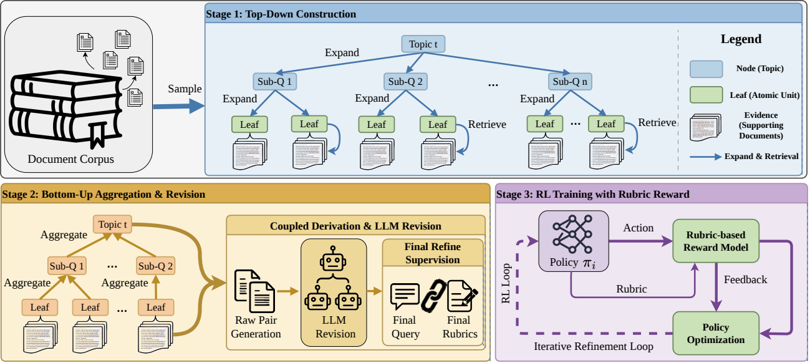
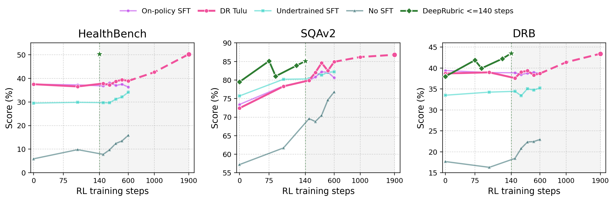

<div align="center">

<h4> <sub>DeepRubric: Evidence-Tree Rubric Supervision for Efficient Reinforcement Learning of Deep Research Agents</sub></h4>

**Accepted to EMNLP 2026 &middot; Main Conference**

<p>
  <a href="https://arxiv.org/abs/2606.17029"></a>
  <a href="https://zminghang.github.io/DeepRubric-Code/"></a>
  <a href="https://huggingface.co/orange101/DeepRubric"></a>
  <a href="https://huggingface.co/datasets/orange101/DeepRubric-dataset"></a>
</p>

[Overview](#overview) &nbsp;&middot;&nbsp; [Results](#results) &nbsp;&middot;&nbsp; [Downloads](#downloads) &nbsp;&middot;&nbsp; [Quick Start](#quick-start) &nbsp;&middot;&nbsp; [Reproduction](#reproduction-workflow) &nbsp;&middot;&nbsp; [Citation](#citation)

</div>

## Overview

DeepRubric constructs evidence trees from Wikipedia and OpenScholar, then generates research queries and evaluation rubrics from the same evidence. Verified query-rubric pairs are used to train DeepRubric-8B with rubric-based GRPO.

| RL training compute | GRPO update steps | Verified training pairs |
| :---: | :---: | :---: |
| **~750 GPU-hours** | **140** | **9,064** |

### Method

<div align="center">

</div>

| Stage | Description | Implementation |
| :--- | :--- | :--- |
| **1. Construct** | Expand a seed topic into sub-questions and retrieve evidence for the leaves. | [Evidence-tree construction](data_construction/) |
| **2. Synthesize & verify** | Synthesize aligned queries and rubrics, then keep, revise, or drop each sample. | [Synthesis and verification](data_construction/) |
| **3. Train** | Optimize a tool-using research agent with rubric rewards and GRPO. | [Training code](training/verl-tool/) |

## Results

| Model | SQAv2 | ResearchQA | DRB | Average | RL GPU-hours |
| :--- | ---: | ---: | ---: | ---: | ---: |
| Qwen3-8B + Search | 57.2 | 46.3 | 18.2 | 40.6 | 0 |
| DR Tulu-8B (1,900 steps) | **86.8** | 74.3 | 43.4 | 68.2 | ~9,700 |
| **DeepRubric-8B (140 steps)** | 86.0 | **75.2** | **43.6** | **68.3** | **~750** |

Scores and approximate RL GPU-hours are reported in the [paper](https://arxiv.org/abs/2606.17029). Higher benchmark scores are better.

<details>
<summary><strong>Training efficiency curves</strong></summary>



</details>

## Downloads

| Resource | Location | Use |
| :--- | :--- | :--- |
| **DeepRubric-8B** | [Hugging Face model](https://huggingface.co/orange101/DeepRubric) | Released model checkpoint |
| **DeepRubric dataset** | [Hugging Face dataset](https://huggingface.co/datasets/orange101/DeepRubric-dataset) | Query-rubric supervision |
| Wikipedia assets | [ASearcher-Local-Knowledge](https://huggingface.co/datasets/inclusionAI/ASearcher-Local-Knowledge) | Corpus, webpages, index, and E5 model |
| OpenScholar assets | [OpenScholar-DataStore-V3](https://huggingface.co/datasets/OpenSciLM/OpenScholar-DataStore-V3) | Scholarly passages and retrieval indexes |

The repository includes retriever server code. Corpora, indexes, training data, and model weights are downloaded separately. See the [data guide](docs/DATA.md) for the expected layouts.

## Quick Start

### Requirements

Set up the components needed for your task. Using the released model or dataset does not require rebuilding the data or running GRPO training.

| Task | Requirements |
| :--- | :--- |
| Construct and convert data | Python 3.10+, data-processing packages, running retrievers, and an OpenAI-compatible LLM endpoint |
| Serve local retrievers | Wikipedia/OpenScholar assets, PyTorch, GPU-enabled FAISS, and retriever dependencies |
| Train the agent | A compatible CUDA/PyTorch environment, vendored verl and verl-tool, vLLM, FlashAttention, training data, and retrieval/judge endpoints |

These components can use separate environments. See [Environment Setup](docs/ENVIRONMENT.md) for dependency sources, interpreter selection, and judge configuration. The repository does not include a complete environment lock for reproducing the paper.

<details>
<summary><strong>Pipeline stages and service endpoints</strong></summary>

| Stage | Main code | Input | Output |
| --- | --- | --- | --- |
| Deploy retrievers | `scripts/start_retrievers.sh`, `retrievers/` | Downloaded Wikipedia and OpenScholar assets | Local HTTP retriever endpoints |
| Construct evidence trees | `data_construction/recursive_qa_agent_v4.py`, `data_construction/recursive_qa_agent_v44.py` | Retriever endpoints, corpus pages, LLM endpoint | `outputs/*_evidence_trees/` |
| Verify samples | `data_construction/recursive_qa_quality_filter.py` | Evidence-tree records | `outputs/verified_trees/*.jsonl` |
| Convert training data | `data_conversion/` | Verified tree JSONL | `data/query_1001.jsonl`, `train.parquet`, `test.parquet` |
| Train agent | `training/verl-tool/` | Parquet data, model checkpoint, retrievers | GRPO checkpoints and logs |

The same retriever services are intentionally reused during data construction and RL training:

| Use | Environment variable | Default endpoint |
| --- | --- | --- |
| Wikipedia retrieval for tree construction | `WIKI_RETRIEVER_URL` | `http://localhost:8888/retrieve` |
| Wikipedia retrieval for training `search` tool | `SEARCH_URL` | `http://localhost:8888/retrieve` |
| Wikipedia page lookup for training `browse` tool | `BROWSE_URL` | `http://localhost:8888/access` |
| OpenScholar retrieval for tree construction | `OPENSCHOLAR_RETRIEVER_URL` | `http://localhost:8000/search` |
| OpenScholar retrieval for training `scholar` tool | `SCHOLAR_URL` | `http://localhost:8000/search` |

</details>

### Installation

<details>
<summary><strong>Install the training and data-construction dependencies</strong></summary>

Clone the repository:

```bash
git clone https://github.com/ZMingHang/DeepRubric-Code.git
cd DeepRubric-Code
```

For data construction and conversion, use a Python 3.10+ environment:

```bash
python -m pip install openai aiohttp requests numpy pandas tqdm transformers huggingface-hub pyarrow
```

For training, activate a compatible CUDA/PyTorch environment and install the vendored packages from the repository root:

```bash
python -m pip install -e './training/verl-tool/verl[vllm]'
python -m pip install -e './training/verl-tool/verl[gpu]' --no-build-isolation
python -m pip install -e ./training/verl-tool
python -m pip install openai aiohttp requests fastapi uvicorn
```

The `vllm` extra declares the rollout backend; the `gpu` extra includes FlashAttention and Liger Kernel. FlashAttention must match your PyTorch/CUDA stack. The legacy dependency list is `training/verl-tool/verl/requirements.txt`; there is no `training/verl-tool/requirements.txt`.

Retriever serving has separate dependencies, including GPU-enabled FAISS. See [Environment Setup](docs/ENVIRONMENT.md#retriever-serving) before starting the services.

</details>

### Configuration

<details>
<summary><strong>Configure the synthesis and verification models</strong></summary>

Configure an OpenAI-compatible endpoint for evidence-tree construction and quality verification:

```bash
export OPENAI_BASE_URL=http://localhost:8008/v1
export OPENAI_API_KEY=EMPTY
```

Do not bind this LLM service to port `8000` if you use the default OpenScholar retriever, because OpenScholar serves `http://localhost:8000/search`.

Data construction and offline verification use these model variables. The model IDs below are examples and must be available at your endpoint:

```bash
export QA_MODEL=deepseek/deepseek-chat
export EXTRACT_MODEL=Qwen/Qwen3.5-35B-A3B-Instruct
export JUDGE_MODEL=gpt-5.1
```

Training uses separate judge variables; `JUDGE_MODEL` does not configure RL rewards:

```bash
export RUBRIC_JUDGE_MODEL=Qwen/Qwen3-30B-A3B-Instruct-2507
export CITATION_JUDGE_MODEL=Qwen/Qwen3-30B-A3B-Instruct-2507
```

These names are the training code's defaults. Set them to model IDs served by your endpoint. The judges use `OPENAI_BASE_URL` and `OPENAI_API_KEY` unless their endpoint-specific overrides are set. See [LLM services](docs/ENVIRONMENT.md#llm-services).

</details>

### Asset Paths and Endpoints

<details>
<summary><strong>Local data paths, corpus layout, and retriever URLs</strong></summary>

The retriever server code is included under `retrievers/`. Set paths to your local data copies. The defaults in the scripts are virtual placeholders and must be replaced for a real run:

```bash
export WIKI_RETRIEVER_ROOT=/path/to/ASearcher-Local-Knowledge
export OPENSCHOLAR_DATA_ROOT=/path/to/OpenScholar-DataStore-V3
```

Expected Wikipedia layout:

```text
$WIKI_RETRIEVER_ROOT/
  e5.index/e5_Flat.index
  wiki_corpus.jsonl
  wiki_webpages.jsonl
  wikilinks.json
  e5-base-v2/
```

For OpenScholar, `retrievers/openscholar/start_single_node.sh` passes `OPENSCHOLAR_DATA_ROOT` into the vendored Hydra config so it points to your local datastore and index files.

Set the default endpoints used by both data construction and training:

```bash
export WIKI_RETRIEVER_URL=http://localhost:8888/retrieve
export WIKI_BROWSE_URL=http://localhost:8888/access
export OPENSCHOLAR_RETRIEVER_URL=http://localhost:8000/search
export SEARCH_URL="$WIKI_RETRIEVER_URL"
export BROWSE_URL="$WIKI_BROWSE_URL"
export SCHOLAR_URL="$OPENSCHOLAR_RETRIEVER_URL"
```

</details>

### Run the Pipeline

With retrievers and judge services already running, execute the pipeline from the data-processing environment. If training uses a separate environment, set its interpreter:

```bash
export PYTHON_BIN=/path/to/verl-tool-env/bin/python
bash scripts/run_pipeline.sh
```

If the current environment also contains both retrievers' dependencies, the wrapper can start them:

```bash
START_RETRIEVERS=1 bash scripts/run_pipeline.sh
```

`scripts/run_pipeline.sh` uses the active `python` for data processing; `PYTHON_BIN` selects the training interpreter only. The retriever launchers use the active `python`/`python3`. Check asset paths, served model IDs, ports, and GPU assignments before running the template.

## Reproduction Workflow

Run the following stages separately to inspect intermediate outputs. The examples use the environment variables from [Quick Start](#quick-start).

<details>
<summary><strong>1. Deploy retrievers</strong></summary>

Start both retrievers and keep the process running:

```bash
bash scripts/start_retrievers.sh
```

This writes logs to:

```text
outputs/retriever_logs/wiki.log
outputs/retriever_logs/openscholar.log
```

You can also start them separately:

```bash
bash retrievers/wiki/launch_local_server.sh
bash retrievers/openscholar/start_single_node.sh
```

The training scripts expect the same endpoints through `SEARCH_URL`, `BROWSE_URL`, and `SCHOLAR_URL`. Override them only if you changed the retriever ports.

</details>

<details>
<summary><strong>2. Construct evidence trees</strong></summary>

Generate Wikipedia evidence trees:

```bash
python data_construction/recursive_qa_agent_v4.py \
  --pages "$WIKI_RETRIEVER_ROOT/wiki_webpages.jsonl" \
  --links "$WIKI_RETRIEVER_ROOT/wikilinks.json" \
  --save outputs/wiki_evidence_trees \
  --retriever-url "$WIKI_RETRIEVER_URL" \
  --qa-model "$QA_MODEL" \
  --extract-model "$EXTRACT_MODEL" \
  --n 1000
```

Generate OpenScholar evidence trees:

```bash
python data_construction/recursive_qa_agent_v44.py \
  --pages "$OPENSCHOLAR_DATA_ROOT/passages/raw_passages-0-of-16.jsonl" \
  --save outputs/openscholar_evidence_trees \
  --retriever-url "$OPENSCHOLAR_RETRIEVER_URL" \
  --qa-model "$QA_MODEL" \
  --extract-model "$EXTRACT_MODEL" \
  --n 1000
```

Outputs:

```text
outputs/wiki_evidence_trees/
outputs/openscholar_evidence_trees/
```

</details>

<details>
<summary><strong>3. Verify and export samples</strong></summary>

Run the verifier and export retained or revised records:

```bash
mkdir -p outputs/verified_trees

python data_construction/recursive_qa_quality_filter.py \
  --input outputs/wiki_evidence_trees \
  --output-dir outputs/wiki_audited \
  --revised-output outputs/verified_trees/wiki_verified.jsonl \
  --include-keep-in-revised \
  --judge-model "$JUDGE_MODEL"

python data_construction/recursive_qa_quality_filter.py \
  --input outputs/openscholar_evidence_trees \
  --output-dir outputs/openscholar_audited \
  --revised-output outputs/verified_trees/openscholar_verified.jsonl \
  --include-keep-in-revised \
  --judge-model "$JUDGE_MODEL"
```

The verifier checks query-rubric alignment, evidence support, merge faithfulness, rubric atomicity, redundancy, and scoring validity.

</details>

<details>
<summary><strong>4. Convert to training data</strong></summary>

Convert verified tree records to query-rubric JSONL:

```bash
python data_conversion/read_form_tree_revise.py \
  --input-dir outputs/verified_trees \
  --output-dir data \
  --output-file query_1001.jsonl
```

Convert JSONL to verl-tool parquet:

```bash
python data_conversion/preprocess_search_r1_dataset_tool.py \
  --input_file data/query_1001.jsonl \
  --local_dir training/verl-tool/data/deeprubric \
  --test_size 10
```

Outputs:

```text
data/query_1001.jsonl
training/verl-tool/data/deeprubric/train.parquet
training/verl-tool/data/deeprubric/test.parquet
```

</details>

<details>
<summary><strong>5. Start GRPO training</strong></summary>

Keep the retrievers running, then launch training:

```bash
cd training/verl-tool

export MODEL_PATH=Qwen/Qwen3-8B
export PYTHON_BIN=/path/to/verl-tool-env/bin/python
export DATASET_NAME=deeprubric
export N_GPUS_PER_NODE=8
export TRAIN_BATCH_SIZE=64
export TRAINER_LOGGER="['console']"

export SEARCH_URL=http://localhost:8888/retrieve
export BROWSE_URL=http://localhost:8888/access
export SCHOLAR_URL=http://localhost:8000/search

bash examples/train/deepsearch/train_4b_tool.sh
```

Useful overrides:

```bash
export TRAIN_DATA=/path/to/train.parquet
export VAL_DATA=/path/to/test.parquet
export CHECKPOINT_DIR=/path/to/checkpoints
export LOG_DIR=/path/to/logs
export PYTHON_BIN=/path/to/verl-tool-env/bin/python
export TOOL_SERVER_HOST=0.0.0.0
export TOOL_SERVER_PORT=30500
export WORKERS_PER_TOOL=16
```

The training script starts the internal verl-tool server with:

```text
tool_search_multi,tool_browse,tool_scholar_multi
```

Those tools call the external retriever endpoints above during rollout.

</details>

<details>
<summary><strong>Full pipeline execution order</strong></summary>

The Quick Start command is a wrapper around the step-by-step workflow above. It runs:

```text
retriever startup, if START_RETRIEVERS=1
  -> Wikipedia tree construction
  -> OpenScholar tree construction
  -> quality verification
  -> JSONL conversion
  -> parquet conversion
  -> GRPO training startup
```

</details>

## Repository Structure

| Directory | Contents |
| :--- | :--- |
| [`retrievers/`](retrievers/) | Wikipedia and OpenScholar server code and launch wrappers |
| [`data_construction/`](data_construction/) | Evidence-tree construction, query-rubric synthesis, and verification |
| [`data_conversion/`](data_conversion/) | Verified tree JSONL to training JSONL and parquet conversion |
| [`training/verl-tool/`](training/verl-tool/) | Training framework and DeepRubric GRPO entrypoints |
| [`scripts/`](scripts/) | Retriever startup and full-pipeline scripts |
| [`docs/`](docs/) | Project page, paper figures, and data setup guide |

## Notes

- The paper uses Wikipedia and OpenScholar as source corpora and retains roughly 9K verified query-rubric pairs.
- The released scripts use placeholder paths such as `/path/to/...`; replace them with your local data locations.
- No generated training data, model checkpoints, logs, private IPs, or API keys are included.
- Evaluation can swap the local training tools for live search APIs if they implement the same tool interface.

## Citation

[arXiv preprint arXiv:2606.17029](https://arxiv.org/abs/2606.17029) (2026).

```bibtex
@misc{zhu2026deeprubricevidencetreerubricsupervision,
  title         = {{DeepRubric}: Evidence-Tree Rubric Supervision for Efficient Reinforcement Learning of Deep Research Agents},
  author        = {Minghang Zhu and Chuyang Wei and Junhao Xu and Yilin Cheng and Zhumin Chen and Jiyan He},
  year          = {2026},
  eprint        = {2606.17029},
  archivePrefix = {arXiv},
  primaryClass  = {cs.CL},
  url           = {https://arxiv.org/abs/2606.17029}
}
```
